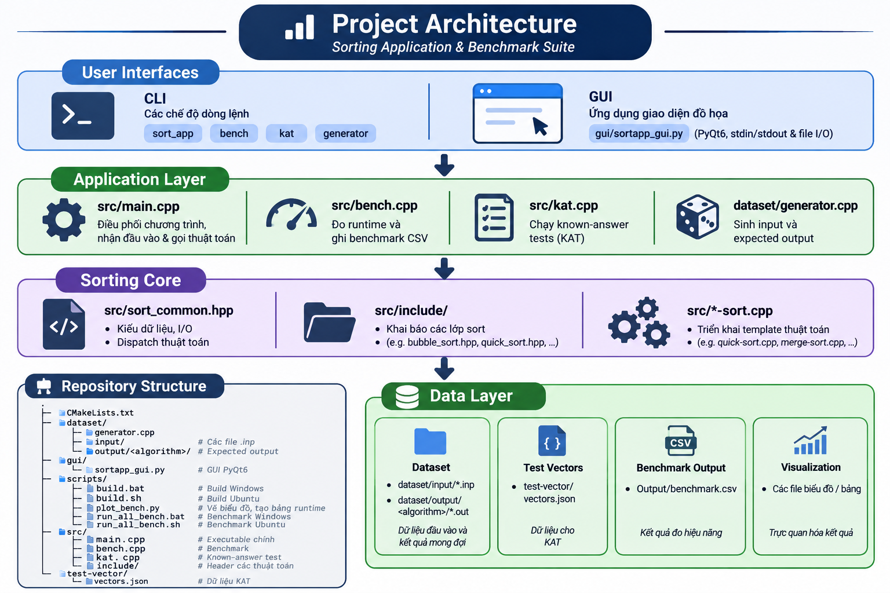
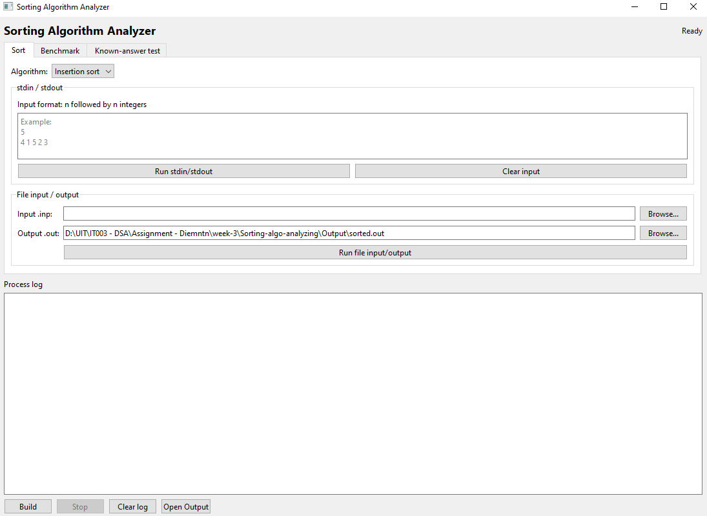

<p align="center">
  <a href="https://www.uit.edu.vn/" title="University of Information Technology">
    
  </a>
</p>

<h1 align="center">Sorting Algorithm Analysis Assignment</h1>

---

**Authors**

- Nguyen Minh Thanh - ATTT2025.3 - 25521710
- Nguyen Cong Tuan - ATTT2025.3 - 25522012
- Tran Lam Nguyen - ATTT2025.2 - 25521257

**Subject:** Data Structures and Algorithms (DSA) - IT003

**Class:** IT003.R14

---

This C++17 project implements, tests, and benchmarks five sorting algorithms:

1. Insertion sort
2. Selection sort
3. Heap sort
4. Merge sort
5. Quick sort

## Project structure

```text
.
├── CMakeLists.txt
├── dataset/
│   ├── generator.cpp
│   ├── input/                  # Input .inp files
│   └── output/<algorithm>/     # Expected output for each algorithm
├── gui/
│   └── sortapp_gui.py          # PyQt6 GUI
├── scripts/
│   ├── build.bat               # Windows build script
│   ├── build.sh                # Ubuntu build script
│   ├── plot_bench.py           # Runtime charts and tables
│   ├── run_all_bench.bat       # Windows benchmark script
│   └── run_all_bench.sh        # Ubuntu benchmark script
├── src/
│   ├── main.cpp                # Main executable entry point
│   ├── bench.cpp               # Benchmark implementation
│   ├── kat.cpp                 # Known-answer test implementation
│   └── include/                # Sorting algorithm headers
└── test-vector/
    └── vectors.json            # Known-answer test data
```

## Architecture

### Layer overview



### Main execution flow

1. `dataset/generator.cpp` creates input files containing `n` and an integer
   array. With `--out` or `--all`, it uses `std::sort` to create expected
   output files for every algorithm.
2. `src/main.cpp` is the entry point of `sort_app` and dispatches modes:
   - No arguments: read stdin, select an algorithm, and write stdout.
   - `--file`: read one `.inp` file, sort it, and write one `.out` file.
   - `--benchmark`: delegate to `runBenchmark`.
   - `--kat`: delegate to `runKnownAnswerTests`.
3. `src/sort_common.hpp` provides shared functionality:
   - `readArray` and `writeArray` handle the input/output format.
   - `runSort` dispatches algorithms by IDs `1..5`.
   - `readExpected` loads expected output.
   - `algoDir` and `toOutputPath` map algorithms to output directories.
4. `src/bench.cpp` reads `.inp` files, runs all five algorithms, compares their
   results with expected output, measures runtime, and writes CSV records.
5. `scripts/plot_bench.py` only processes rows for `01.inp` through `19.inp`,
   then creates runtime charts and CSV/Markdown tables. The GUI launches the
   existing CLI executables through `QProcess` instead of duplicating C++ logic.

### Build targets

`CMakeLists.txt` defines the `sort_core` interface library to share the `src/`
include path. The main targets are:

```text
sort_app  = main.cpp + bench.cpp + kat.cpp
bench     = bench.cpp + bench_main.cpp
kat       = kat.cpp + kat_main.cpp
generator = dataset/generator.cpp
```

The `*-sort.cpp` files contain template implementations and are included
directly by `sort_common.hpp`; they are not compiled as separate objects.
This ensures that template definitions are visible wherever `runSort` is used.

### Responsibilities

| Component | Responsibility | Does not handle |
|---|---|---|
| `sort_app` | Interactive sorting, file I/O, benchmark, and KAT CLI modes | Chart rendering |
| `gui/sortapp_gui.py` | GUI for sorting, benchmarking, and KAT | Algorithm implementation |
| `bench` / `bench.cpp` | Runtime measurement and expected-output checking | Chart rendering |
| `kat` / `kat.cpp` | Ascending and descending vector tests | Dataset benchmarking |
| `scripts/plot_bench.py` | Charts and tables for tests `01..19` | Running sorting algorithms |
| `dataset/generator` | Input and expected-output generation | Runtime measurement |

## Requirements

### Windows

- CMake
- Ninja
- MinGW g++ at `C:\msys64\mingw64\bin\g++.exe`
- Python 3
- Python packages: `PyQt6`, `matplotlib`

### Ubuntu

```bash
sudo apt update
sudo apt install -y build-essential cmake ninja-build python3 python3-pip
```

The default compiler is `/usr/bin/g++`.

## Build

### Windows

```bat
scripts\build.bat
```

Or run CMake directly:

```powershell
cmake -S . -B build -G Ninja `
  -DCMAKE_CXX_COMPILER=C:\msys64\mingw64\bin\g++.exe
cmake --build build --parallel
```

### Ubuntu

```bash
chmod +x scripts/build.sh
./scripts/build.sh
```

Or:

```bash
cmake -S . -B build -G Ninja -DCMAKE_CXX_COMPILER=/usr/bin/g++
cmake --build build --parallel
```

The following executables are created in `build/`:

- `sort_app`: main executable with all CLI modes.
- `bench`: standalone benchmark executable.
- `kat`: standalone known-answer test executable.
- `generator`: dataset generator.

## Generate test data

Build the project first, then run:

```powershell
.\build\generator.exe --all
```

Ubuntu:

```bash
./build/generator --all
```

Options:

```text
--inp, -i    Generate 50 input files
--out, -o    Generate expected output from existing input
--all, -a    Generate both input and expected output
--help, -h   Show help
```

The generator creates:

- `dataset/input/01.inp` through `dataset/input/50.inp`.
- Tests `01` through `19` with the default sizes:
  `100`, `1000`, `10000` through `80000`, `100000` through `800000`,
  and `1000000`.
- Tests `20` through `50` with random sizes up to `1000000`.
- Expected output at `dataset/output/<algorithm>/01.out` through `50.out`.

The default seed is `20261101`, so the dataset is reproducible.

## Run the main executable

Show all CLI help:

```powershell
.\build\sort_app.exe --help
```

### 1. stdin/stdout

Input consists of `n` followed by `n` integers. With no arguments, the
program asks for an algorithm ID from `1` to `5`, then prints `n` and the
sorted array.

```powershell
@"
3
5 1 4
"@ | .\build\sort_app.exe
```

Output:

```text
3
1 4 5
```

Ubuntu:

```bash
printf "3\n5 1 4\n" | ./build/sort_app
```

### 2. File input/output

```powershell
.\build\sort_app.exe --file `
  dataset\input\01.inp `
  Output\01.out `
  heap
```

The algorithm can be specified by ID or name:

```text
1 / insertion
2 / selection
3 / heap
4 / merge
5 / quick
```

The output file contains `n` on the first line, followed by the sorted array
in ascending order.

## Benchmark

The benchmark runs all five algorithms on `.inp` files, checks their results
against expected output, and writes runtime data to CSV.

```powershell
.\build\sort_app.exe --benchmark `
  --in dataset\input `
  --out dataset\output `
  --csv Output\benchmark.csv `
  --repeat 3 `
  --timeout 180
```

Ubuntu:

```bash
./build/sort_app --benchmark \
  --in dataset/input \
  --out dataset/output \
  --csv Output/benchmark.csv \
  --repeat 3 \
  --timeout 180
```

Benchmark options:

```text
--in DIR              Input directory, default: dataset/input
--out DIR             Expected output directory, default: dataset/output
--csv FILE            CSV output path
--repeat N            Repetitions per test, default: 3
--timeout SEC         Time limit per run, default: 180 seconds
--skip-after-tle      Infer TLE for subsequent larger sizes
```

The CSV columns are:

```text
file,n,algorithm,avg_ms,min_ms,status
```

## Charts and runtime tables

After creating `Output/benchmark.csv`, run the plotting script. It only uses
the first 19 tests, from `01.inp` through `19.inp`; rows for `20.inp` through
`50.inp` are ignored.

```bash
python3 scripts/plot_bench.py \
  --input Output/benchmark.csv \
  --output-dir Output
```

Windows:

```powershell
py scripts\plot_bench.py `
  --input Output\benchmark.csv `
  --output-dir Output
```

Generated files:

- `Output/runtime_comparison.png`: runtime across the first 19 tests.
- `Output/runtime_comparison_selected_sizes.png`: comparison at `1e3`, `1e4`,
  `1e5`, and `1e6`.
- `Output/runtime_table.csv` and `Output/runtime_table.md`: table for the
  first 19 tests.
- `Output/runtime_selected_sizes.csv` and
  `Output/runtime_selected_sizes.md`: table for the four selected sizes.
- `Output/algorithms/<algorithm>/runtime_by_size.png`: runtime curve for one
  algorithm.
- `Output/algorithms/<algorithm>/runtime_selected_sizes.png`: selected-size
  chart for one algorithm, when the corresponding rows are available.
- `Output/algorithms/<algorithm>/relative_runtime_growth.png`: runtime growth
  relative to the first measured payload.
- `Output/algorithms/<algorithm>/<algorithm>_runtime.csv/.md`: detailed
  per-algorithm runtime table.

The charts use logarithmic axes to make both `O(n^2)` and `O(n log n)`
algorithms visible.

## Run the complete benchmark workflow

Windows:

```bat
scripts\run_all_bench.bat
```

Ubuntu:

```bash
chmod +x scripts/run_all_bench.sh
./scripts/run_all_bench.sh
```

The script:

1. Builds the project if the executable does not exist.
2. Runs the benchmark for all five algorithms.
3. Writes `Output/benchmark.csv`.
4. Generates charts and runtime tables.

## Known-answer test

KAT reads `test-vector/vectors.json` and checks both ascending and descending
results.

```powershell
.\build\sort_app.exe --kat `
  --vectors test-vector\vectors.json `
  --timeout 10
```

Ubuntu:

```bash
./build/sort_app --kat \
  --vectors test-vector/vectors.json \
  --timeout 10
```

Filter by algorithm or category:

```text
--algo heap|insertion|selection|merge|quick|1..5
--category best|worst|normal|edge
-v                         Show passing tests
```

Example:

```bash
./build/kat --algo quick --category edge -v
```

## PyQt6 GUI

Install dependencies:

```bash
python3 -m pip install PyQt6 matplotlib
```

Windows:

```powershell
py -m pip install PyQt6 matplotlib
py gui\sortapp_gui.py
```

Ubuntu:

```bash
python3 gui/sortapp_gui.py
```

The GUI integrates all `sort_app` CLI features:

- Run stdin/stdout sorting with a manually entered array.
- Run file `.inp` to `.out` sorting.
- Select one of the five algorithms.
- Run the complete benchmark with configurable repeat and timeout values.
- Run known-answer tests with algorithm/category filters and verbose output.
- Generate benchmark charts and runtime tables.
- Build `sort_app` from the `Build` button.

The interface uses `Sort`, `Benchmark`, and `Known-answer test` tabs. Chart
generation still only processes `01.inp` through `19.inp`, following the
rules of `scripts/plot_bench.py`.



## Notes

- Run commands from the repository root.
- `insertion` and `selection` are `O(n^2)` and may be very slow for large
  payloads.
- On Windows, benchmark timeout uses a thread; a timed-out worker may
  continue consuming CPU until the benchmark process ends.
- Do not commit generated files in `Output/`, `build/`, or executable files.
