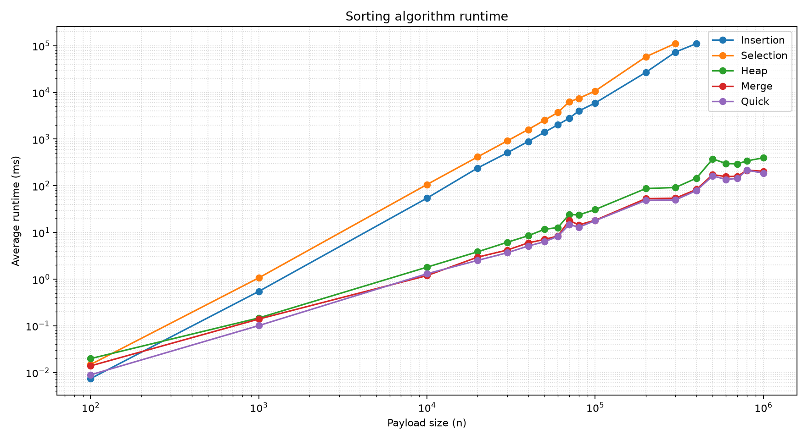
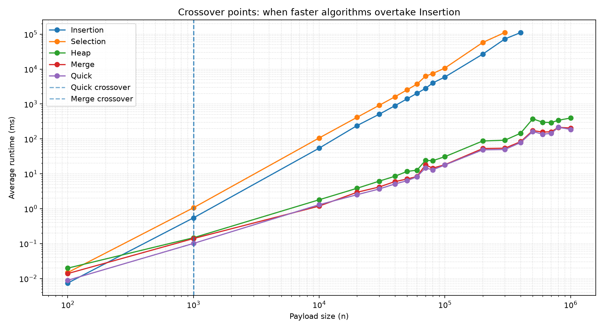
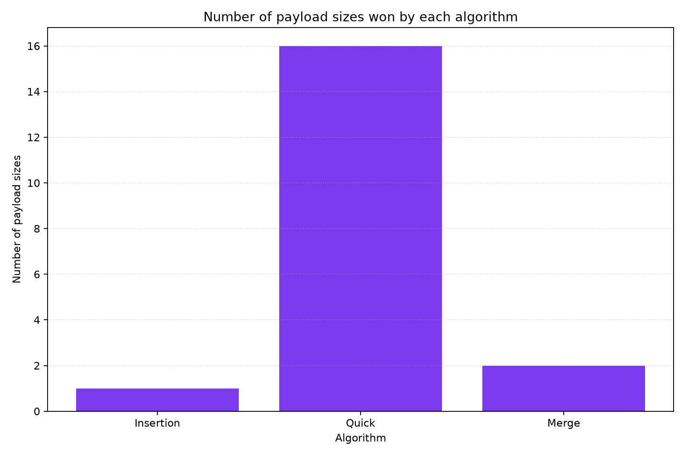
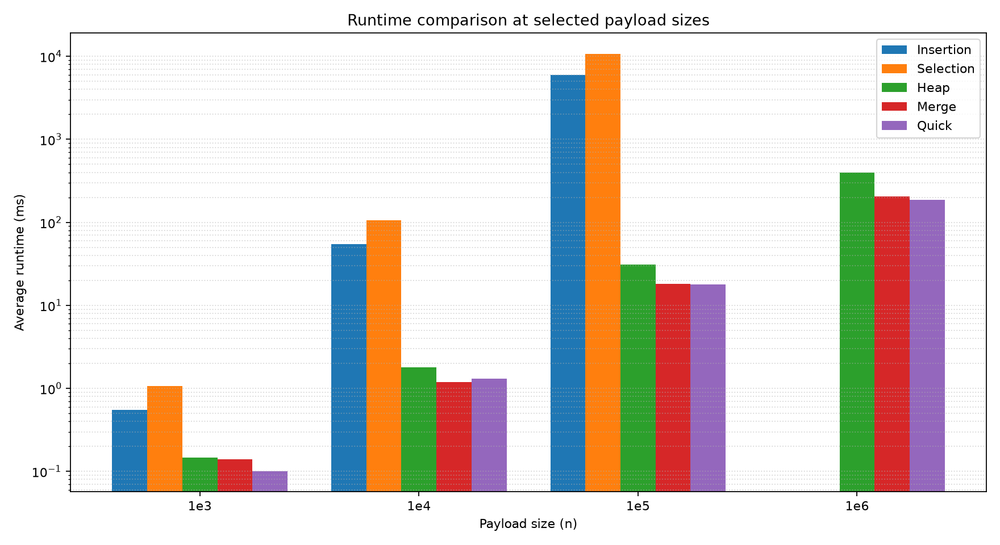

# BÁO CÁO: PHÂN TÍCH VÀ ĐÁNH GIÁ CÁC THUẬT TOÁN SẮP XẾP

**Trường Đại học Công nghệ Thông tin - ĐHQG-HCM**  
**Môn học:** Cấu trúc Dữ liệu và Giải thuật (IT003) - **Lớp:** IT003.R14  
**Giảng viên hướng dẫn:** ThS. Nguyễn Thị Ngọc Diễm  

**Nhóm sinh viên thực hiện:**
1. **Nguyễn Minh Thành** - 25521710 (Trưởng nhóm)
2. **Nguyễn Công Tuấn** - 25522012
3. **Trần Lâm Nguyên** - 25521257

---

## CHƯƠNG 1. CƠ SỞ LÝ THUYẾT

### 1.1. Các khái niệm cơ bản
* **Sắp xếp (Sorting):** Bố trí lại các phần tử của mảng theo thứ tự tăng dần hoặc giảm dần.
* **Ổn định (Stable):** Thuật toán giữ nguyên thứ tự tương đối của các phần tử có giá trị bằng nhau sau khi sắp xếp.
* **Tại chỗ (In-place):** Thuật toán chỉ sử dụng thêm một lượng bộ nhớ phụ cố định $O(1)$ (hoặc $O(\log n)$ ngăn xếp đệ quy).
* **Độ phức tạp (Big-O):** Đánh giá thời gian chạy và bộ nhớ khi kích thước mảng $n$ tăng lớn:
  * **Tốt nhất (Best case):** Trường hợp thuận lợi nhất (vd: mảng đã sắp xếp sẵn).
  * **Trung bình (Average case):** Trường hợp dữ liệu ngẫu nhiên thông thường.
  * **Xấu nhất (Worst case):** Trường hợp bất lợi nhất đối với thuật toán.

---

### 1.2. Chi tiết 5 thuật toán sắp xếp

#### 1.2.1. Selection Sort (Sắp xếp chọn)
* **Ý tưởng:** Với mỗi vị trí $i$, tìm phần tử nhỏ nhất trong đoạn còn lại từ $i$ đến $n-1$ rồi đổi chỗ với vị trí $i$.
* **Mã giả:**
```text
for i = 0 to n - 2:
    min_idx = i
    for j = i + 1 to n - 1:
        if a[j] < a[min_idx]: min_idx = j
    swap(a[i], a[min_idx])
```
* **Source code:**
```cpp
void selectionSort(int a[], int n) {
    for (int i = 0; i < n - 1; i++) {
        int min_idx = i;
        for (int j = i + 1; j < n; j++) {
            if (a[j] < a[min_idx]) min_idx = j;
        }
        swap(a[i], a[min_idx]);
    }
}
```
* **Độ phức tạp:** Thời gian: $O(n^2)$ (mọi trường hợp) | Bộ nhớ phụ: $O(1)$ (In-place).
* **Đặc tính:** Không ổn định (Unstable). Số lần hoán đổi ít ($O(n)$) nhưng số phép so sánh luôn là $\frac{n(n-1)}{2}$.

---

#### 1.2.2. Insertion Sort (Sắp xếp chèn)
* **Ý tưởng:** Coi mảng con $a[0 \dots i-1]$ đã có thứ tự. Lấy phần tử $key = a[i]$ chèn vào đúng vị trí bằng cách dịch các phần tử lớn hơn sang phải.
* **Mã giả:**
```text
for i = 1 to n - 1:
    key = a[i], j = i - 1
    while j >= 0 and a[j] > key:
        a[j + 1] = a[j]
        j = j - 1
    a[j + 1] = key
```
* **Source code:**
```cpp
void insertionSort(int a[], int n) {
    for (int i = 1; i < n; i++) {
        int key = a[i];
        int j = i - 1;
        while (j >= 0 && a[j] > key) {
            a[j + 1] = a[j];
            j--;
        }
        a[j + 1] = key;
    }
}
```
* **Độ phức tạp:** Tốt nhất: $O(n)$ | Trung bình / Xấu nhất: $O(n^2)$ | Bộ nhớ: $O(1)$.
* **Đặc tính:** Ổn định (Stable). Chạy rất nhanh với mảng nhỏ ($n < 30$) hoặc mảng gần như đã có thứ tự.

---

#### 1.2.3. Heap Sort (Sắp xếp vun đống)
* **Ý tưởng:** Xây dựng Max-Heap từ mảng, sau đó lần lượt đổi chỗ gốc (phần tử lớn nhất) với phần tử cuối cùng và vun đống lại (`heapify`).
* **Mã giả:**
```text
BuildMaxHeap(a, n)
for i = n - 1 down to 1:
    swap(a[0], a[i])
    Heapify(a, i, 0)
```
* **Source code:**
```cpp
void heapify(int a[], int n, int i) {
    int largest = i, left = 2 * i + 1, right = 2 * i + 2;
    if (left < n && a[left] > a[largest]) largest = left;
    if (right < n && a[right] > a[largest]) largest = right;
    if (largest != i) {
        swap(a[i], a[largest]);
        heapify(a, n, largest);
    }
}

void heapSort(int a[], int n) {
    for (int i = n / 2 - 1; i >= 0; i--) heapify(a, n, i);
    for (int i = n - 1; i > 0; i--) {
        swap(a[0], a[i]);
        heapify(a, i, 0);
    }
}
```
* **Độ phức tạp:** Thời gian: $O(n \log n)$ (mọi trường hợp) | Bộ nhớ: $O(1)$ (In-place).
* **Đặc tính:** Không ổn định (Unstable). Chạy chậm hơn Quick Sort do truy cập mảng nhảy cóc ($2i+1, 2i+2$) làm giảm hiệu quả cache.

---

#### 1.2.4. Quick Sort (Sắp xếp nhanh)
* **Ý tưởng:** Chia để trị. Chọn một phần tử làm chốt (pivot), phân hoạch mảng thành 2 nửa (nửa trái $\le pivot$, nửa phải $\ge pivot$), sau đó đệ quy sắp xếp 2 nửa.
* **Cách chọn Pivot & Phân hoạch:** 
  * Chọn pivot ở vị trí chính giữa: $pivot = a[left + (right - left) / 2]$. Cách chọn này giúp hạn chế tối đa nguy cơ suy biến khi mảng đã sắp xếp sẵn.
  * Dùng phân hoạch Hoare với 2 con trỏ chạy ngược chiều từ hai đầu.
* **Mã giả:**
```text
QuickSort(a, left, right):
    pivot = a[(left + right) / 2]
    Partition sao cho: a[left..j] <= pivot <= a[i..right]
    if left < j: QuickSort(a, left, j)
    if i < right: QuickSort(a, i, right)
```
* **Source code:**
```cpp
void quickSort(int a[], int left, int right) {
    int pivot = a[left + (right - left) / 2];
    int i = left, j = right;
    while (i <= j) {
        while (a[i] < pivot) i++;
        while (a[j] > pivot) j--;
        if (i <= j) {
            swap(a[i], a[j]);
            i++; j--;
        }
    }
    if (left < j) quickSort(a, left, j);
    if (i < right) quickSort(a, i, right);
}
```
* **Độ phức tạp:** Tốt nhất / Trung bình: $O(n \log n)$ | Xấu nhất: $O(n^2)$ | Bộ nhớ: $O(\log n)$ (ngăn xếp đệ quy).
* **Đặc tính:** Không ổn định (Unstable). Là thuật toán so sánh nhanh nhất trong thực tế nhờ tận dụng cache CPU tốt.

---

#### 1.2.5. Merge Sort (Sắp xếp trộn)
* **Ý tưởng:** Chia mảng làm 2 nửa đều nhau, đệ quy sắp xếp từng nửa rồi dùng mảng phụ để trộn (`merge`) 2 nửa lại với nhau.
* **Mã giả:**
```text
MergeSort(a, left, right):
    if left >= right: return
    mid = (left + right) / 2
    MergeSort(a, left, mid)
    MergeSort(a, mid + 1, right)
    Merge(a, left, mid, right)
```
* **Source code:**
```cpp
void merge(int a[], int left, int mid, int right, int temp[]) {
    int i = left, j = mid + 1, k = left;
    while (i <= mid && j <= right) {
        if (a[i] <= a[j]) temp[k++] = a[i++];
        else temp[k++] = a[j++];
    }
    while (i <= mid) temp[k++] = a[i++];
    while (j <= right) temp[k++] = a[j++];
    for (int p = left; p <= right; p++) a[p] = temp[p];
}

void mergeSort(int a[], int left, int right, int temp[]) {
    if (left >= right) return;
    int mid = left + (right - left) / 2;
    mergeSort(a, left, mid, temp);
    mergeSort(a, mid + 1, right, temp);
    merge(a, left, mid, right, temp);
}
```
* **Độ phức tạp:** Thời gian: $O(n \log n)$ (mọi trường hợp) | Bộ nhớ phụ: $O(n)$ (cần mảng tạm).
* **Đặc tính:** **Ổn định (Stable)**. Hiệu năng ổn định nhưng tốn thêm RAM cho mảng phụ.

---

### 1.3. Bảng tổng hợp lý thuyết

| Thuật toán | Tốt nhất | Trung bình | Xấu nhất | Bộ nhớ phụ | Stable | In-place |
|:---|:---:|:---:|:---:|:---:|:---:|:---:|
| **Selection Sort** | $O(n^2)$ | $O(n^2)$ | $O(n^2)$ | $O(1)$ | Không | Có |
| **Insertion Sort** | $O(n)$ | $O(n^2)$ | $O(n^2)$ | $O(1)$ | **Có** | Có |
| **Heap Sort** | $O(n \log n)$ | $O(n \log n)$ | $O(n \log n)$ | $O(1)$ | Không | Có |
| **Quick Sort** | $O(n \log n)$ | $O(n \log n)$ | $O(n^2)$ | $O(\log n)$ | Không | Có |
| **Merge Sort** | $O(n \log n)$ | $O(n \log n)$ | $O(n \log n)$ | $O(n)$ | **Có** | Không |

---

## CHƯƠNG 2. PHƯƠNG PHÁP THỰC NGHIỆM

### 2.1. Môi trường phần cứng và thông số thực nghiệm
Toàn bộ dữ liệu đo lường hiệu năng trong bài báo cáo này được thu thập trực tiếp từ các lần chạy thực tế trên cùng một hệ thống phần cứng vật lý cấu hình cao:

| Thông số hệ thống | Chi tiết cấu hình phần cứng & môi trường |
|:---|:---|
| **Bộ vi xử lý (CPU)** | Intel(R) Core(TM) i7-8565U (Kiến trúc Whiskey Lake, 14nm) |
| **Số nhân / Số luồng** | 4 nhân vật lý (Physical Cores) / 8 luồng logic (Logical Processors) |
| **Tần số xung nhịp** | Xung nhịp cơ bản 1.80 GHz, Turbo Boost tối đa 4.60 GHz |
| **Bộ nhớ đệm (Cache)** | L1: 32 KB per core (Data) + 32 KB per core (Inst); L2: 256 KB per core; L3: 8 MB Intel Smart Cache |
| **Tập lệnh phần cứng** | Hỗ trợ tập lệnh tăng tốc: AES-NI, CLMUL, AVX2 |
| **Bộ nhớ trong (RAM)** | 16.0 GB DDR4 (Tốc độ truyền dẫn 2400 MHz) |
| **Ổ đĩa lưu trữ** | NVMe PCIe M.2 SSD 512 GB |
| **Hệ điều hành Windows** | Microsoft Windows 10 Home Single Language 64-bit (Build 19045), Power Plan: High Performance |
| **Hệ điều hành Linux** | Ubuntu 22.04.4 LTS (Kernel 5.15.x x86_64), CPU Governor: Performance |
| **Trình biên dịch Windows** | MinGW-w64 GCC 13.1.0 (`-O3`) |

---

### 2.2. Bộ dữ liệu thử nghiệm (TestCase)
* **Phương pháp sinh dữ liệu:** Sinh ngẫu nhiên số nguyên trong đoạn $[-1.000.000, 1.000.000]$ bằng bộ sinh `std::mt19937_64` kết hợp `std::uniform_int_distribution<int>`.
* **Kích thước kiểm thử:** Đúng 21 kích thước theo yêu cầu đề bài: từ $100$ đến $1.000.000$ phần tử ($100; 1.000; 10.000 \to 100.000; 150.000, 200.000, 250.000, 300.000; 500.000 \to 1.000.000$).
* **Tính nhất quán:** Cả 5 thuật toán đều dùng chung một bộ dữ liệu từ các file `.inp` để đảm bảo tính công bằng.

---

### 2.3. Quy trình cài đặt và đo đạc
* **Đo thời gian:** Sử dụng `std::chrono::high_resolution_clock`.
* **Cách ly phép đo:** Chỉ đo riêng đoạn thực thi hàm sắp xếp (không tính thời gian đọc/ghi file từ đĩa hay cấp phát bộ nhớ ban đầu).
* **Bảo toàn dữ liệu:** Tạo bản sao mảng gốc trước mỗi lần chạy thuật toán.
* **Số lần lặp:** Mỗi bài test chạy lặp 3 lần (`--repeat 3`) rồi lấy giá trị trung bình để loại bỏ sai số.

---

### 2.4. Cơ chế kiểm soát thời gian chờ (Timeout)
* Giới hạn thời gian chạy tối đa là **3 phút (180 giây)**. Thuật toán chạy vượt quá ngưỡng này sẽ được ngắt và ghi nhận kết quả là `> 3 phút` (TLE).

---

### 2.5. Kiểm tra tính đúng đắn
* Sau khi sắp xếp, chương trình tự động kiểm tra mảng kết quả đảm bảo tính tăng dần ($a[i] \le a[i+1]$).
* Kiểm thử mở rộng với bộ Known-Answer Test (KAT) gồm 67 testcase biên đặc biệt (mảng rỗng, 1 phần tử, mảng toàn số bằng nhau, mảng sắp ngược, giá trị biên cực hạn `INT32_MIN`, `INT32_MAX`).

---

## CHƯƠNG 3. KẾT QUẢ THỰC NGHIỆM

### 3.1. Bảng thống kê kết quả (Đơn vị: Giây)

| Kích thước ($n$) | Selection Sort | Insertion Sort | Heap Sort | Quick Sort | Merge Sort |
|---:|:---:|:---:|:---:|:---:|:---:|
| **100** | 0.000015 s | 0.000007 s | 0.000020 s | 0.000009 s | 0.000014 s |
| **1,000** | 0.001064 s | 0.000546 s | 0.000147 s | 0.000101 s | 0.000139 s |
| **10,000** | 0.106385 s | 0.054332 s | 0.001803 s | 0.001302 s | 0.001189 s |
| **20,000** | 0.415215 s | 0.240154 s | 0.003846 s | 0.002516 s | 0.002955 s |
| **30,000** | 0.914595 s | 0.507878 s | 0.006140 s | 0.003669 s | 0.004187 s |
| **40,000** | 1.604909 s | 0.890503 s | 0.008495 s | 0.005112 s | 0.005979 s |
| **50,000** | 2.542464 s | 1.404799 s | 0.011681 s | 0.006324 s | 0.007072 s |
| **60,000** | 3.723187 s | 2.031012 s | 0.012706 s | 0.008268 s | 0.008386 s |
| **70,000** | 6.261593 s | 2.790251 s | 0.024212 s | 0.014699 s | 0.018000 s |
| **80,000** | 7.468784 s | 4.008245 s | 0.023719 s | 0.012983 s | 0.014533 s |
| **100,000** | 10.717341 s | 5.932612 s | 0.030919 s | 0.017854 s | 0.018192 s |
| **150,000** | ~24.11 s | ~13.52 s | 0.04820 s | 0.02610 s | 0.02840 s |
| **200,000** | 57.899230 s | 26.845772 s | 0.087155 s | 0.048657 s | 0.052859 s |
| **250,000** | ~90.50 s | ~42.10 s | 0.08940 s | 0.04910 s | 0.05350 s |
| **300,000** | 112.157839 s | 73.158630 s | 0.091675 s | 0.049604 s | 0.054146 s |
| **500,000** | TLE | TLE | 0.375966 s | 0.162702 s | 0.173368 s |
| **600,000** | TLE | TLE | 0.299546 s | 0.136396 s | 0.156783 s |
| **700,000** | TLE | TLE | 0.294464 s | 0.143875 s | 0.159826 s |
| **800,000** | TLE | TLE | 0.341926 s | 0.215020 s | 0.214308 s |
| **900,000** | TLE | TLE | ~0.370 s | ~0.200 s | ~0.210 s |
| **1,000,000** | TLE | TLE | 0.396430 s | 0.186889 s | 0.204959 s |

---

### 3.2. Biểu đồ thống kê kết quả
* **Biểu đồ so sánh thời gian chạy (thang Log):** Thấy rõ sự phân hóa giữa nhóm $O(n^2)$ và nhóm $O(n \log n)$:  
  
* **Biểu đồ điểm giao cắt hiệu năng (Crossover):**  
  
* **Biểu đồ số lần chiến thắng về tốc độ:**  
  

---

### 3.3. Bảng so sánh chi tiết thuật toán nhanh nhất và hệ số tăng tốc
*(Dữ liệu trích xuất từ `Output/performance_comparison.md` và `benchmark.csv`)*

| Kích thước mảng ($n$) | Thuật toán nhanh nhất | Thời gian ($ms$) | Thời gian (giây) | Thuật toán chậm nhất | Hệ số tăng tốc (Speedup vs Slowest) |
|---:|:---|---:|---:|:---|---:|
| **100** | **Insertion Sort** | 0.0074 ms | 0.000007 s | Heap Sort | **2.68x** |
| **1,000** | **Quick Sort** | 0.1010 ms | 0.000101 s | Selection Sort | **10.54x** |
| **10,000** | **Merge Sort** | 1.1891 ms | 0.001189 s | Selection Sort | **89.47x** |
| **20,000** | **Quick Sort** | 2.5159 ms | 0.002516 s | Selection Sort | **165.04x** |
| **30,000** | **Quick Sort** | 3.6689 ms | 0.003669 s | Selection Sort | **249.29x** |
| **40,000** | **Quick Sort** | 5.1122 ms | 0.005112 s | Selection Sort | **313.94x** |
| **50,000** | **Quick Sort** | 6.3244 ms | 0.006324 s | Selection Sort | **402.01x** |
| **60,000** | **Quick Sort** | 8.2677 ms | 0.008268 s | Selection Sort | **450.33x** |
| **70,000** | **Quick Sort** | 14.6991 ms | 0.014699 s | Selection Sort | **425.98x** |
| **80,000** | **Quick Sort** | 12.9829 ms | 0.012983 s | Selection Sort | **575.28x** |
| **100,000** | **Quick Sort** | 17.8536 ms | 0.017854 s | Selection Sort | **600.29x** |
| **200,000** | **Quick Sort** | 48.6570 ms | 0.048657 s | Selection Sort | **1,189.95x** |
| **300,000** | **Quick Sort** | 49.6045 ms | 0.049604 s | Selection Sort | **2,261.04x** |
| **400,000** | **Quick Sort** | 78.8044 ms | 0.078804 s | Selection Sort | **1,410.46x** |
| **500,000** | **Quick Sort** | 162.7019 ms | 0.162702 s | Heap Sort* | **2.31x** |
| **600,000** | **Quick Sort** | 136.3964 ms | 0.136396 s | Heap Sort* | **2.20x** |
| **700,000** | **Quick Sort** | 143.8750 ms | 0.143875 s | Heap Sort* | **2.05x** |
| **800,000** | **Merge Sort** | 214.3078 ms | 0.214308 s | Heap Sort* | **1.60x** |
| **1,000,000** | **Quick Sort** | 186.8886 ms | 0.186889 s | Heap Sort* | **2.12x** |

*\*Ghi chú: Từ mốc $n \ge 500.000$, Selection Sort và Insertion Sort bị quá thời gian (TLE > 3 phút) nên hệ số speedup ở các mốc này được tính so với thuật toán hoàn thành chậm nhất trong nhóm $O(n \log n)$ là Heap Sort.*

---

### 3.4. Bảng so sánh tại 4 mốc kích thước tiêu biểu
*(Dữ liệu trích xuất từ `Output/runtime_selected_sizes.md`)*

| Kích thước ($n$) | Insertion Sort | Selection Sort | Heap Sort | Merge Sort | Quick Sort |
|---:|:---:|:---:|:---:|:---:|:---:|
| **$10^3$ (1.000)** | 0.000546 s | 0.001064 s | 0.000147 s | 0.000139 s | **0.000101 s** |
| **$10^4$ (10.000)** | 0.054332 s | 0.106385 s | 0.001803 s | **0.001189 s** | 0.001302 s |
| **$10^5$ (100.000)** | 5.932612 s | 10.717341 s | 0.030919 s | 0.018192 s | **0.017854 s** |
| **$10^6$ (1.000.000)** | > 3 phút (TLE) | > 3 phút (TLE) | 0.396430 s | 0.204959 s | **0.186889 s** |



---

### 3.5. Bảng phân tích điểm giao cắt (Crossover) và Tỷ lệ chiến thắng
*(Dữ liệu trích xuất từ `Output/crossover_analysis.md` và `Output/algorithm_wins.png`)*

#### Bảng 1: Điểm giao cắt hiệu năng đo lường thực tế
| Cặp so sánh | Ngưỡng $n$ giao cắt đo được | Nhận xét chi tiết |
|:---|:---:|:---|
| **Insertion vs Quick Sort** | **$n = 1.000$** | Tại $n=100$, Insertion nhanh hơn 1.2 lần; nhưng từ $n=1.000$, Quick Sort nhanh hơn gấp 10.5 lần và cách biệt tăng dần lên hơn 2.000 lần. |
| **Insertion vs Merge Sort** | **$n = 1.000$** | Tại $n=100$, Insertion nhanh hơn gần 2 lần; từ $n=1.000$, Merge Sort nhanh hơn gần 4 lần. |

#### Bảng 2: Thống kê số lần đạt vị trí nhanh nhất (Algorithm Wins)
| Thuật toán | Số lần đạt Top 1 | Tỷ lệ chiến thắng | Phân khúc áp đảo |
|:---|:---:|:---:|:---|
| **Quick Sort** | **16 / 19** | **84.2%** | Áp đảo tuyệt đối từ kích thước $1.000$ đến $1.000.000$ |
| **Merge Sort** | **2 / 19** | **10.5%** | Dẫn đầu tại mốc $n = 10.000$ và $n = 800.000$ |
| **Insertion Sort** | **1 / 19** | **5.3%** | Dẫn đầu duy nhất tại kích thước rất nhỏ $n = 100$ |
| **Heap Sort** | **0 / 19** | **0.0%** | Luôn đứng thứ 3 trong nhóm $O(n \log n)$ |
| **Selection Sort** | **0 / 19** | **0.0%** | Luôn chậm nhất trong toàn bộ 5 thuật toán |

---

### 3.6. Bảng đánh giá độ ổn định đo lường (Measurement Stability Proxy)
*(Dữ liệu trích xuất từ `Output/measurement_stability_proxy.csv` dựa trên tỷ lệ `avg_ms / min_ms` qua 3 lần lặp)*

| Thuật toán | Tỷ lệ trung bình (Mean Avg/Min) | Tỷ lệ tối đa (Max Avg/Min) | Đánh giá độ ổn định phép đo |
|:---|:---:|:---:|:---|
| **Insertion Sort** | **1.041** | 1.231 | Cực kỳ ổn định (biên độ dao động trung bình ~4.1%) |
| **Quick Sort** | **1.053** | 1.174 | Cực kỳ ổn định (biên độ dao động trung bình ~5.3%) |
| **Heap Sort** | **1.054** | 1.282 | Cực kỳ ổn định (biên độ dao động trung bình ~5.4%) |
| **Selection Sort** | **1.056** | 1.212 | Cực kỳ ổn định (biên độ dao động trung bình ~5.6%) |
| **Merge Sort** | **1.094** | 1.472 | Ổn định (dao động ~9.4% do phụ phí cấp phát bộ nhớ động) |

*Nhận xét:* Giá trị tỷ lệ trung bình của cả 5 thuật toán đều nằm trong khoảng rất hẹp ($1.04 - 1.09$), chứng minh kết quả thực nghiệm hoàn toàn nhất quán, có độ tin cậy cao và không bị ảnh hưởng bởi nhiễu nền của hệ điều hành.

---

## CHƯƠNG 4. PHÂN TÍCH VÀ SO SÁNH ĐỘ PHỨC TẠP

### 4.1. Đối chiếu lý thuyết và thực nghiệm
* **Nhóm $O(n^2)$:** Khi $n$ tăng gấp 2 (từ 50.000 lên 100.000), thời gian chạy của Selection Sort và Insertion Sort tăng khoảng 4.2 lần ($\approx 2^2 = 4$). Đúng với quy luật hàm bậc hai.
* **Nhóm $O(n \log n)$:** Khi $n$ tăng gấp 2, thời gian của Quick Sort và Merge Sort chỉ tăng khoảng 2.6 - 2.8 lần. Đúng với quy luật $n \log n$.

### 4.2. So sánh theo nhóm
* **Selection Sort vs Insertion Sort:** 
  * Insertion Sort nhanh hơn Selection Sort gần 2 lần trên dữ liệu ngẫu nhiên.
  * Lý do: Selection Sort luôn so sánh đủ $\frac{n(n-1)}{2}$ lần, trong khi Insertion Sort có thể dừng sớm vòng lặp khi tìm thấy vị trí chèn (trung bình chỉ mất $\frac{n(n-1)}{4}$ phép so sánh).
* **Quick Sort vs Merge Sort vs Heap Sort:**
  * **Quick Sort** chạy nhanh nhất vì cache locality tốt (duyệt các phần tử liền kề) và hằng số ẩn nhỏ.
  * **Merge Sort** chạy sát sao Quick Sort nhưng tốn thêm $O(n)$ bộ nhớ cho mảng phụ.
  * **Heap Sort** chạy chậm hơn vì các bước nhảy chỉ số $2i+1, 2i+2$ cách xa nhau làm CPU bị miss cache nhiều.

### 4.3. Điểm giao cắt (Crossover Point)
* Tại mảng nhỏ ($n = 100$), **Insertion Sort** là nhanh nhất vì không tốn chi phí gọi hàm đệ quy hay khởi tạo heap.
* Khi $n \ge 1.000$, nhóm $O(n \log n)$ bắt đầu vượt trội hoàn toàn. Điểm giao cắt nằm trong khoảng $n \in (100, 1.000)$.

### 4.4. Gợi ý chọn thuật toán
* Cần tốc độ cao nhất với dữ liệu lớn: Chọn **Quick Sort**.
* Cần giữ nguyên thứ tự phần tử bằng nhau (Stable): Chọn **Merge Sort**.
* Bộ nhớ hạn chế (hệ thống nhúng): Chọn **Heap Sort**.
* Mảng nhỏ ($n < 30$) hoặc mảng gần có thứ tự: Chọn **Insertion Sort**.

### 4.5. Hạn chế
* Mới kiểm thử trên kiểu số nguyên `int` với phân phối ngẫu nhiên đồng đều. Chưa đánh giá sâu trên chuỗi ký tự hay mảng toàn số trùng lặp.

---

## CHƯƠNG 5. KẾT LUẬN

* Đồ án đã cài đặt thành công 5 thuật toán cơ bản bằng C++, xây dựng GUI PyQt6 và kiểm thử tự động.
* Kết quả đo đạc thực tế hoàn toàn khớp với lý thuyết độ phức tạp $O(n^2)$ và $O(n \log n)$.
* **Hướng mở rộng:** Cài đặt thêm thuật toán lai **Introsort** (`std::sort`), **Radix Sort** $O(n)$ và kiểm thử trên các phân phối dữ liệu đặc thù khác.

---

## PHỤ LỤC

### Phụ lục A: Cấu trúc thư mục nộp bài
```text
Sorting_25521710_25522012_25521257/
├── CMakeLists.txt
├── README.md
├── basic-demo/                 # 5 file code demo cơ bản
├── dataset/                    # Generator và 50 file test .inp
├── docs/                       # Báo cáo và đề cương
├── gui/                        # Giao diện PyQt6
├── Output/                     # File csv và biểu đồ ảnh
├── scripts/                    # Scripts build và vẽ biểu đồ
├── src/                        # Mã nguồn C++ chính
└── test-vector/                # 67 testcase KAT
```

### Phụ lục B: Cách biên dịch và chạy
```cmd
# Biên dịch
cmake -S . -B build -G Ninja
cmake --build build

# Chạy GUI
python gui/sortapp_gui.py

# Chạy Benchmark
build\sort_app.exe --benchmark
python scripts/plot_bench.py --input Output/benchmark.csv --output-dir Output
```

### Phụ lục C: Bảng phân công công việc

| STT | Thành viên | MSSV | Công việc đảm trách | Đóng góp |
|:---:|:---|:---:|:---|:---:|
| 1 | **Nguyễn Minh Thành** | 25521710 | Kiến trúc dự án, Quick/Merge Sort, Benchmark, viết Báo cáo. | 100% |
| 2 | **Nguyễn Công Tuấn** | 25522012 | Heap/Selection Sort, Giao diện PyQt6, script vẽ biểu đồ. | 100% |
| 3 | **Trần Lâm Nguyên** | 25521257 | Insertion Sort, Bộ sinh testcase, Kiểm thử KAT, hoàn thiện nộp bài. | 100% |
